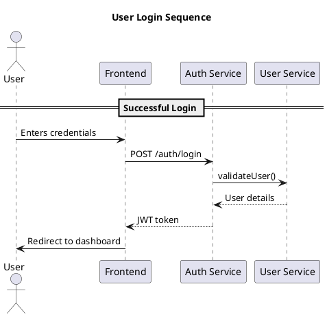

# Authentication Diagrams

This directory contains PlantUML diagrams for the Authentication module.

The current checked-in diagrams are sequence diagrams only. Add other diagram types only when the corresponding source files are created.

## Directory Structure

```text
docs/diagrams/auth/
  README.md
  sequences/
    login.puml
    otp_flow.puml
    password_reset.puml
    register.puml
```

## Generating Diagrams

### Prerequisites

1. Install PlantUML:

   ```bash
   # For Windows (using Chocolatey)
   choco install plantuml

   # For macOS (using Homebrew)
   brew install plantuml

   # For Linux (Debian/Ubuntu)
   sudo apt-get install plantuml
   ```

2. Install GraphViz (for layout):

   ```bash
   # Windows
   choco install graphviz

   # macOS
   brew install graphviz

   # Linux
   sudo apt-get install graphviz
   ```

### Generate All Diagrams

```powershell
Get-ChildItem -Path docs/diagrams/auth -Recurse -Filter *.puml |
  ForEach-Object { plantuml -tsvg $_.FullName }
```

### Generate Single Diagram

```powershell
plantuml -tsvg docs/diagrams/auth/sequences/login.puml
```

## Viewing Diagrams

### VS Code Extension

1. Install "PlantUML" extension by jebbs
2. Open any .puml file
3. Use `Alt+D` to preview the diagram

### Online Viewer

1. Copy the PlantUML code
2. Paste into [PlantUML Web Server](http://www.plantuml.com/plantuml/uml/)

## Diagram Standards

1. **Naming conventions**
   - Keep existing PlantUML files as lowercase with underscores for consistency.
   - Use kebab-case for new draw.io or Penpot support files.
   - Be descriptive but concise
   - Example: `password_reset.puml`

2. **Style guidelines**
   - Use consistent colors and styles
   - Include proper titles and legends
   - Keep diagrams focused on a single flow

3. **Version control**
   - Commit source diagrams.
   - Commit generated exports only when they are useful for review without local tooling.
   - Update diagrams when the related spec or implementation behavior changes.

## Adding New Diagrams

1. Create a new .puml file in the appropriate directory
2. Follow existing patterns
3. Add a reference in this README
4. Generate an SVG export when review requires it

## Example Diagram


