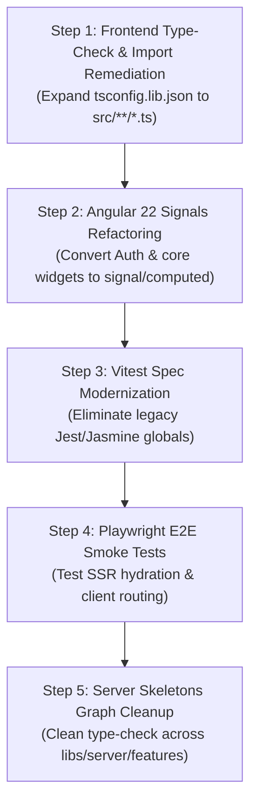

# Infrastructure Upgrade Cycle Memo — Status & Forward Roadmap

**Last Updated:** 2026-10-26  
**Status:** Nx 24 & Angular 22 Cycle Completed (PR #91 Merged); Workspace Adoption Plan Documented; NestJS 12 Deferred

---

## 1. Executive Status: Completed vs. Pending

| Workstream                       | Status                 | Details / Target Version                                                                                                                  |
| -------------------------------- | ---------------------- | ----------------------------------------------------------------------------------------------------------------------------------------- |
| **Nx Monorepo Core**             | **COMPLETED**          | Upgraded from `23.0.1` to **`24.0.1`**; inferred plugins active (`@nx/jest/plugin`, `@nx/eslint/plugin`, `@nx/vitest`)                    |
| **Angular Framework & Material** | **COMPLETED**          | Upgraded from `21.2.9` to **`22.2.4`** (Signals, Standalone, SSR hydration, `ChangeDetectionStrategy.OnPush`)                             |
| **Frontend Tooling & Compilers** | **COMPLETED**          | `vite.config.mts` modernized (native `tsconfigPaths`); `typescript@6.0.3`; `angular-eslint@22.6.0`; `@analogjs/vite-plugin-angular@2.7.5` |
| **Database ORM Strategy**        | **RETAINED**           | **Prisma ORM 6.15.0** retained as sole standard; `$queryRaw`/`TypedSql` for complex CTEs/analytics                                        |
| **Workspace Infra Adoption**     | **READY TO EXECUTE**   | Technical housekeeping sprint: `tsconfig.lib.json` inclusion, Signals refactor, Vitest spec cleanup, and Playwright E2E smoke tests       |
| **Backend Framework & Tests**    | **DEFERRED (Pending)** | **NestJS 11.1.27 + Jest** baseline preserved; 100% test coverage maintained on `server-feature-auth`                                      |
| **Express 5 Alignment**          | **DEFERRED (Pending)** | Express 4 (`4.21.2`) retained; deferred to align concurrently with NestJS 12                                                              |

---

## 2. Completed in This Cycle (2026-10-26 — PR #91)

The infrastructure upgrade cycle was executed on branch `chore/nx24-angular22-upgrade` and merged into `main` via PR #91. Full details are recorded in [`docs/infra-upgrade/20261026-nx24-angular22/migration-report.md`](docs/infra-upgrade/20261026-nx24-angular22/migration-report.md).

### A. Nx 24 Migration & Deprecation Cleanup

- Upgraded workspace to **Nx `24.0.1`** cleanly with standard npm install (**zero `--legacy-peer-deps`**).
- Converted deprecated explicit executors (`@nx/jest:jest`, `@nx/eslint:lint`) to modern inferred target plugins.
- Executed all 42 automated Nx/Angular migrations and cleaned up temporary migration assets.

### B. Frontend Vite Modernization

- Updated all 14 `vite.config.mts` files across `apps/web/*` and `libs/web/*`.
- Removed deprecated `@nx/vite` plugins (`nxViteTsPaths`, `nxCopyAssetsPlugin`) in favor of native Vite `resolve: { tsconfigPaths: true }`.

### C. Angular 22 & Component Architecture

- Upgraded `@angular/*` packages, Angular Material, and CDK from `21.2.9` to **`22.2.4`**.
- Aligned all frontend components across `apps/web/*` and `libs/web/*` to `ChangeDetectionStrategy.OnPush`.
- Hardened TypeScript tsconfigs to resolve to source and eliminate stale `dist/` path shadowing in Vitest.
- Fixed `nx.json` `targetDefaults.test.configurations.ci` to use `"coverage": true` for compatibility with both Vitest and Jest runners.

### D. Full Validation Baseline

- **Backend Unit Tests:** 172/172 passed (100% statement, branch, function, line coverage) on `server-feature-auth`.
- **Backend Integration Tests:** 158/158 passed (100% coverage) against local PostgreSQL/Redis.
- **Frontend Tests:** 14/14 web test projects passed under Vitest (`web-lib-partner` 71/71, `web-lib-public` 41/41, `web-lib-customer` 16/16).
- **Workspace Validation:** 17 project type-checks passed (0 errors); 27 project lints passed (0 errors, 0 warnings); all 4 production applications built successfully.
- **Codex Automated PR Review:** Approved with 👍 on PR #91.

---

## 3. Retained Architectural Decisions

### A. Database ORM Strategy: Retain Prisma ORM as Primary Standard

- **Why Prisma Remains Our Standard:** Prisma is a **100% stateless data mapper and query builder**. It maintains no identity map or first-level cache, never throws lazy loading exceptions, and returns plain TypeScript objects (POJOs).
- **Mandate for Complex Queries (10–15% of workloads):** For complex reporting, aggregations, window functions, or multi-table CTEs, **do not abandon Prisma or introduce secondary ORMs.** Instead:
  1. Use Prisma's native SQL escape hatches: **`$queryRaw`** and **`TypedSql`**.
  2. Implement database queries inside concrete infrastructure adapters (`libs/server/infrastructure`) behind Hexagonal repository interfaces (`libs/server/contracts-*`), keeping domain logic decoupled.

---

## 4. Next Session: Full Workspace Adoption of the Infra Upgrade

While the tooling and runtime dependencies are upgraded to Nx 24 and Angular 22, the existing codebase contains legacy prototype artifacts that have not yet fully adopted the new infrastructure standards.

This is a **purely technical housekeeping effort** that does not require waiting for new backend business features. A ready-to-run AIDD prompt is preserved in [`docs/infra-upgrade/20261026-nx24-angular22/workspace-adoption-prompt.md`](docs/infra-upgrade/20261026-nx24-angular22/workspace-adoption-prompt.md). It will be executed in the next session as a focused Technical Modernization sprint:

### A. Current Gaps in Workspace Infra Adoption

| Domain                                   | Current Outdated State                                                                                                                      | Required Infra Adoption Action                                                                                                                                                            |
| ---------------------------------------- | ------------------------------------------------------------------------------------------------------------------------------------------- | ----------------------------------------------------------------------------------------------------------------------------------------------------------------------------------------- |
| **1. TypeScript Compilation Inclusion**  | Non-auth directories in `libs/web/{customer,partner,admin}` are excluded from `tsconfig.lib.json` `include` to bypass legacy import errors. | Fix obsolete imports (`../../models/*`) and expand `include: ["src/**/*.ts"]` across all web libraries so `nx run-many -t type-check` verifies 100% of frontend files under TypeScript 6. |
| **2. Angular 22 Signals Modernization**  | Existing components use legacy Angular patterns (getter-based state, `@Input()` decorators, constructor DI, manual RxJS subscriptions).     | Refactor components to Angular 22 reactive primitives: `signal()`, `computed()`, `input()`, `output()`, and `inject()`.                                                                   |
| **3. Vitest Spec Modernization**         | Legacy unit tests in `libs/web/partner` contain Jest/Jasmine globals (`vi` namespace typing, `fail()`).                                     | Update specs to standard Vitest assertion syntax so `nx run-many -t test` passes cleanly with zero runner warnings.                                                                       |
| **4. E2E Playwright Smoke Tests**        | `apps/e2e/web/{customer,partner,admin}` only contain `lint-placeholder.ts`. `apps/e2e/api` has a trivial dummy test.                        | Build verified Playwright smoke tests exercising SSR rendering and client-side hydration for each web persona.                                                                            |
| **5. Server Feature Skeleton Alignment** | 9 legacy backend directories in `libs/server/features/` fail strict `tsc` checks against current `server-core` / Prisma types.              | Align or prune legacy skeletons so `nx run-many -t type-check` validates cleanly across the entire server domain.                                                                         |

### B. Step-by-Step Execution Plan (For Next Session)



1. **Step 1: Expand Frontend Type-Checking (`tsconfig.lib.json`):**
   - Resolve broken relative model imports in `libs/web/customer` and `libs/web/partner`.
   - Update `tsconfig.lib.json` in all web libraries to `include: ["src/**/*.ts"]`.
   - Verify `nx run-many -t type-check` passes cleanly across all 14 web projects.
2. **Step 2: Migrate Components to Angular 22 Signals:**
   - Convert `LoginComponent`, `RegisterComponent`, and active dashboard widgets to use `signal()`, `computed()`, `input()`, and `inject()`.
   - Ensure `ChangeDetectionStrategy.OnPush` operates seamlessly with signal notifications.
3. **Step 3: Standardize Vitest Specs:**
   - Replace any lingering Jest/Jasmine calls (`fail()`, `vi` namespace mismatches) with native Vitest assertions.
   - Verify `nx run-many -t test` runs with 100% green suites across all web libraries.
4. **Step 4: Activate Playwright E2E Smoke Tests:**
   - Replace `apps/e2e/web/{customer,partner,admin}/src/lint-placeholder.ts` with real Playwright tests verifying SSR startup and route navigation.
5. **Step 5: Backend Skeletons Cleanup:**
   - Address obsolete imports in `libs/server/features/` or prune unused legacy stubs to ensure full monorepo type-check health.

---

## 5. Deferred Workstreams (Externally Blocked)

### A. NestJS 12 & Backend Vitest Migration (Deferred)

- **The Blocker:** `@nx/nest` (in Nx `24.0.1`) strictly caps its peer dependency range:
  ```json
  {
    "@nestjs/core": ">=10.0.0 <12.0.0",
    "@nestjs/common": ">=10.0.0 <12.0.0"
  }
  ```
  Installing NestJS 12 triggers `ERESOLVE` conflicts under standard npm. Additionally, NestJS 12 publishes strictly pure ESM, which breaks the backend Jest runner without experimental Node VM flags.
- **Trigger for Next Cycle:** Upstream release of official NestJS 12 support in `@nx/nest` with native Rspack and pure ESM generator support.
- **Planned Action:** Upgrade `@nestjs/*` to `12.x` and migrate backend Jest suites to Vitest concurrently once supported natively by Nx.

### B. Express 5 Upgrade (Deferred)

- Express 4 (`4.21.2`) is currently retained.
- The Express 5 (`5.3.0`) upgrade will be executed concurrently with NestJS 12.

### C. Product Slices (Feature Implementation Roadmap)

- Implementation of new business domains (Slice 3: Salon Owner Business & Branch Settings, Slice 4: Staff & Services, Slice 5: Customer CRM, Slice 6: Appointments, etc.) will proceed sequentially per [`docs/specs/project-wide/IMPLEMENTATION/implementation-slicing.md`](docs/specs/project-wide/IMPLEMENTATION/implementation-slicing.md) once infra adoption is complete.
